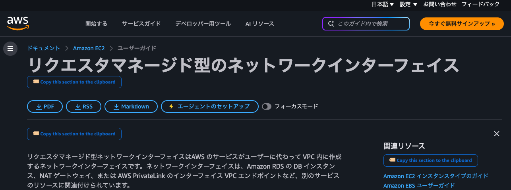

title: get-aws-document-linkTitlePosition
date: 2026-10-13
type: [tampermonkey, userscript, utility]
tags: [aws, docs, clipboard, tampermonkey, greasemonkey, chrome-extension]

# 🏷️ get-aws-document-linkTitlePosition

[](./get-aws-document-linkTitlePosition.user.js)
[](../../LICENSE)
[](https://www.tampermonkey.net/)
[](https://www.greasespot.net/)

A userscript that adds a **copy button** below every H1 / H2 / H3 heading on [AWS documentation](https://docs.aws.amazon.com).  
One click copies the section link with breadcrumb to your clipboard — ready to paste into Slack, Notion, or any notes app.

---

## 📸 Demo



https://github.com/user-attachments/assets/image-movie.mov

---

## ✨ Features

- Adds **🏷️ Copy this section to the clipboard** button below every H1 / H2 / H3 heading
- Automatically includes the **breadcrumb** (e.g. `ドキュメント > Amazon EKS > ユーザーガイド`)
- **H2 / H3** buttons append a `#anchor` fragment to link to the exact section
- Shows **✅ successed!!** for 2 seconds on success
- Works on every page of `docs.aws.amazon.com`

**Copied text format:**

```
[] {Heading text} - {Breadcrumb}
{URL}
```

**Example — H1:**

```
[] Kubernetes の概念 - ドキュメント > Amazon EKS > ユーザーガイド
https://docs.aws.amazon.com/ja_jp/eks/latest/userguide/kubernetes-concepts.html
```

**Example — H2 / H3:**

```
[] クラスターの作成 - ドキュメント > Amazon EKS > ユーザーガイド
https://docs.aws.amazon.com/ja_jp/eks/latest/userguide/create-cluster.html#create-cluster-eksctl
```

---

## 🚀 Installation

### Requirements

Install **Tampermonkey** or **Greasemonkey** in your browser first.  
→ See [../README.md](../README.md) for browser-specific install links.

### Install the script

**Option A — One-click install from GitHub Raw (recommended)**

Open the link below. Tampermonkey will detect the `.user.js` and prompt you to install.

> [**📥 Install get-aws-document-linkTitlePosition.user.js**](https://raw.githubusercontent.com/suguruoo/suguruoo-labs/main/tampermonkey/get-aws-document-linkTitlePosition/get-aws-document-linkTitlePosition.user.js)

**Option B — Manual install**

1. Open [get-aws-document-linkTitlePosition.user.js](./get-aws-document-linkTitlePosition.user.js) and copy the source
2. Open the Tampermonkey dashboard → **Create new script**
3. Paste the code and save

---

## 🖥️ Usage

1. Open any page on [docs.aws.amazon.com](https://docs.aws.amazon.com)
2. A **🏷️ Copy this section to the clipboard** button appears below each H1 / H2 / H3 heading
3. Click a button — the section link is copied to your clipboard
4. **✅ successed!!** is shown for 2 seconds as confirmation
5. Paste anywhere (Slack / Notion / GitHub Issues / etc.)

---

## 🔧 Compatibility

| Browser | Extension | Status |
|---|---|---|
| Chrome | Tampermonkey v5+ | ✅ Tested |
| Firefox | Tampermonkey / Greasemonkey | ✅ Should work |
| Edge | Tampermonkey | ✅ Should work |
| Safari | Tampermonkey | ✅ Should work |

---

## 📋 Changelog

### v2.3.0 (2026-10-14)

- **Fix**: H1 ボタン（ページ最上部）が常にコピー失敗する問題を修正
  - 原因: H1 の `id` が空文字の場合 `document.getElementById('')` が `null` を返し処理終了していた
  - 修正: H1 のみ `document.querySelector('h1').textContent` から直接タイトルを取得する独立フローに分岐
- **Fix**: パンくずリスト (`getBreadcrumb()`) が v2.2.0-diag で欠落していたため復元
  - コピー形式: `[] {タイトル} - {パンくず a} > {パンくず b}\n{URL}` を正しく出力

### v2.2.0 (2026-10-14)

- **Fix**: Tampermonkey v5.5 (Chrome MV3) でクリックイベントが一切届かない問題を根本解決
  - 原因調査: `background.js: run script @` ログ → UserScripts API モードで実行されており、ボタン個別の `addEventListener` が world 分離により発火しない
  - 修正: `document.addEventListener('click', ..., true)` によるイベント委任（キャプチャフェーズ）に切り替え
  - これにより world の種類に関わらずクリックを確実に捕捉できる
- **Fix**: `@grant GM_setClipboard` → `@grant none` + `navigator.clipboard.writeText` に変更
  - `@grant` 指定が world 分離を引き起こしていた根本原因でもあった
  - `navigator.clipboard.writeText` が使えない環境では `execCommand('copy')` にフォールバック

### v1.10.0 (2026-10-13)

- **Feature**: H6 heading にもボタンを追加（例: `<h6>考慮事項</h6>`）
  - H6 は id を持たないため、テキスト内容をキー（`h6:考慮事項`）として重複挿入を防止
  - H6 は id なしのためアンカーなしの URL をコピー
- **Fix**: H1 の挿入先ロジックを再修正
  - `<p>` だけを探していたが、ページによっては `<p>` の前に `<div class="itemizedlist">` が来るため H1 下にボタンが表示されないページがあった
  - `awsdocs-*` / `awsui-*` タグをスキップし、最初のコンテンツ要素（`p` / `div` / `ul` / `ol` / `table` / `h2` など）の前に挿入するよう変更


- **Fix**: H1 ボタンが消える問題を修正
  - v1.8.0 の H1 挿入ロジックが Angular bootstrap 後に `ref = null` になり `appendChild`（末尾）に落ちていた
  - `awsdocs-*` / `awsui-*` タグ名判定を廃止 → **「最初の `<p>` の前に挿入」** というシンプルな基準に変更（bootstrap 前後どちらでも `<p>` は存在する）
- **Refactor**: 固定リトライ（300ms/800ms/2000ms）を廃止 → **MutationObserver で自分の wrapper 削除を検知して 200ms 後に再挿入** する方式に変更
  - Angular の `$compile` は初回のみ発生するため、削除を検知して再挿入すれば以降は削除されない
  - 固定リトライは Angular の `$digest` サイクルとタイミングが合わず誤った位置に挿入されていた
- **Fix**: `CSS.escape()` をクエリセレクタから削除（属性値はクォートで済み不要・誤動作の原因）


- **Fix**: First-inserted (correct) buttons were removed by Angular; re-inserted (polling) buttons landed in wrong place and were unclickable
  - Root cause: 500ms polling competed with Angular's `$compile` cycle — buttons were inserted mid-render and evicted, then re-inserted into the wrong DOM position
  - **Polling removed entirely** — replaced with fixed-delay retries at 300ms / 800ms / 2000ms after `window.load` (after Angular has finished rendering)
- **Fix**: Added `pointer-events: auto; z-index: 9999` to button styles — prevents AWS CSS from blocking clicks
- **Fix**: Removed `e.preventDefault()` / `e.stopPropagation()` from click handler — was interfering with AngularJS event system
- **Fix**: `buildCopyText()` now takes `(headingId, headingTag)` instead of a heading element — no stale closure, always re-fetches from live DOM on click
- **Fix**: `h1[id],h2[id],h3[id]` selector — headings without `id` (TOC / nav items) are excluded at selector level

### v1.7.0 (2026-10-13)

- **Fix**: Buttons appearing in wrong place (inside H1) and not working — root cause was 3 compounding bugs:
  1. `nextElementSibling` check collided with `<awsdocs-page-header-container>` (Angular-managed element between H1 and content), causing infinite re-injection every 500ms
  2. Button click held a stale closure to the heading — after Angular re-rendered the DOM, `heading.id` returned empty and copy silently failed
  3. `querySelectorAll('h1,h2,h3')` included TOC / nav headings outside the main content area
- **Fix**: Duplicate-injection guard now uses `heading.id`-keyed `data-awscopy-for` attribute — survives Angular DOM re-renders
- **Fix**: On click, heading is re-fetched live via `document.getElementById()` — no stale closure
- **Fix**: `findInsertPoint()` skips `awsdocs-*` / `awsui-*` Angular components after H1 to find the first safe sibling
- **Fix**: Scoped target to `#main-col-body` only — excludes TOC, nav, and sidebar headings

### v1.6.1 (2026-10-13)

- **Fix**: 不要なボタン（Cookie 同意バナー・モーダル・フッター等）が表示される問題を修正
  - 原因: `document.querySelectorAll('h1,h2,h3')` でページ全体の heading を取得していたため、`awsccc-*`（Cookie バナー）・`skip-link`（アクセシビリティ）・フッター等の heading にもボタンが挿入されていた
  - 修正: クエリ対象を `#main-col-body` 内に限定（本文コンテンツのみ）

### v1.6.0 (2026-10-13)

- **Fix**: Replaced `navigator.clipboard` with `GM_setClipboard` — clipboard now works on every click without User Activation restrictions

### v1.5.0 (2026-10-13)

- **Design**: Button label changed to `🏷️ Copy this section to the clipboard`
- **Design**: Bold text (`font-weight: 700`), larger border-radius and padding
- **Fix**: Copy-once-per-page bug — switched from persistent attribute mark to per-call sibling check
- **Refactor**: Removed MutationObserver; polling only (500ms x 20)

### v1.4.0 (2026-10-13)

- Added `window.__awscopy_ran` debug flag
- Expanded MutationObserver target to `document.documentElement`

### v1.3.0 (2026-10-13)

- Removed debounce from MutationObserver (was permanently blocked by AngularJS `$digest` cycle)
- Added `setInterval` polling as fallback

### v1.2.0 (2026-10-13)

- Changed `@run-at` to `document-end`
- Fixed Observer permanent-death bug with `isInjecting` mutex + `try/finally`
- Added `heading.isConnected` guard against `parentNode null`

### v1.1.0 (2026-10-13)

- Fixed MutationObserver infinite loop
- Fixed breadcrumb selector to match actual AWS docs DOM (`div#breadcrumbs`)

### v1.0.0 (2026-10-13)

- Initial release

---

## ⚠️ Notes

- `@grant none` を使用しているため、Tampermonkey の GM 関数は一切使用しない
- クリップボードは `navigator.clipboard.writeText`（HTTPS 必須・`docs.aws.amazon.com` は全て HTTPS のため問題なし）
- Tampermonkey v5.5+ (Chrome MV3) で UserScripts API モードが有効な環境でも動作するよう、イベント委任方式を採用
- If the AWS docs DOM structure changes, breadcrumb detection may fail — please open an [Issue](../../../issues)
- H2 / H3 headings without an `id` attribute are excluded from button injection (TOC / nav headings)

---

## 🐛 Bug Reports

Please open an [Issue](../../../issues) and include:

- URL of the affected page
- Browser and Tampermonkey version
- Expected behavior vs actual behavior

---

## 📄 License

[MIT](../../LICENSE) — free to use, modify, and distribute.
